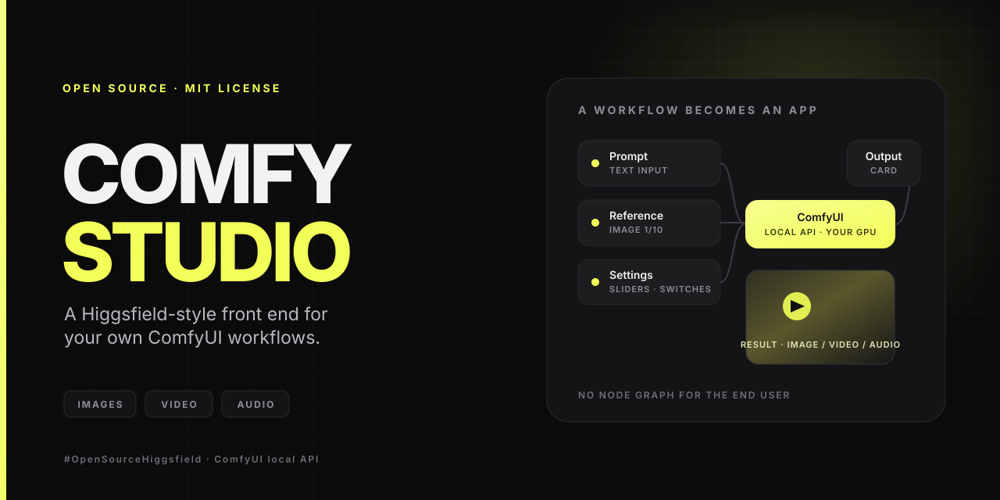
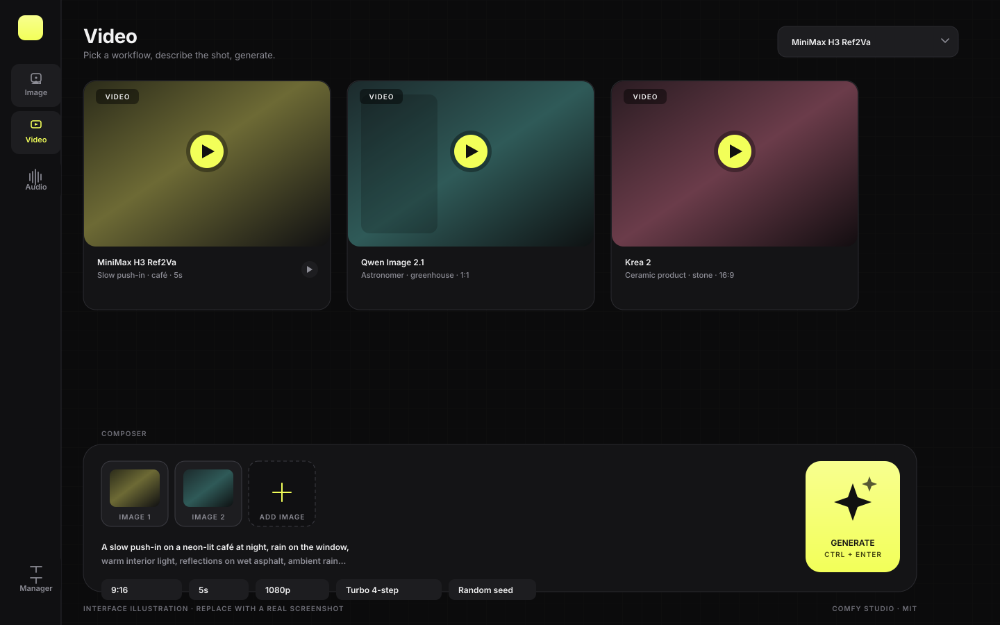
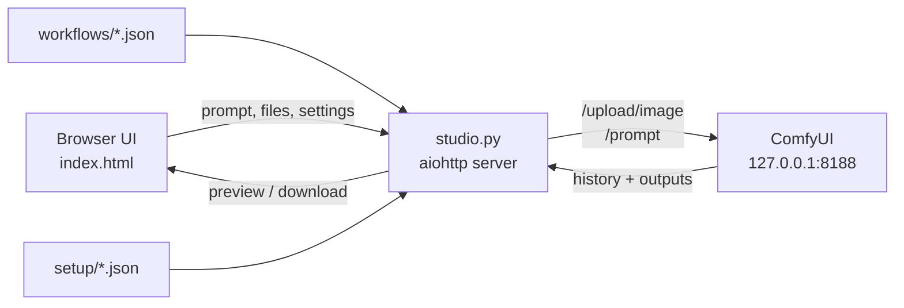

# Comfy Studio

**A Higgsfield-style creative studio for your own ComfyUI workflows.**

Comfy Studio turns ComfyUI API workflows into a clean, prompt-first app: pick a model, type an idea, add reference images or video, adjust the settings that matter, and press **Generate**. No node graph, no terminal commands for the person using it.

Built for the **Open Source Higgsfield** challenge with **#OpenSourceHiggsfield**.

[](LICENSE)


> **Not affiliated with Comfy Org or Higgsfield.** ComfyUI is a trademark of Comfy Org. This is an independent community project.

---

## What it does

Comfy Studio is a small local web app that sits in front of ComfyUI:

- **One prompt box** for image, video, and audio workflows.
- **Model switcher** that reads the API workflows in `workflows/`.
- **Upload slots** for reference images, videos, and audio, including grouped multi-image inputs such as 1/10 … 10/10.
- **Smart controls** generated from node titles: text fields, number fields, dropdowns, toggles, sliders, and fields that only appear when a switch is on.
- **Per-workflow Setup** for model files, so users choose a checkpoint once and the app remembers it.
- **Gallery** with previews, download, and “copy inputs to current generation”.
- **Credit estimate** for ComfyUI API/partner nodes that publish a price badge.
- **Workflow Manager** to add, replace, rename, and delete workflows without editing code.
- **One-click launch** on Windows: starts ComfyUI if needed and opens the studio in your browser.

The backend is a **single Python file** (`studio.py`). The frontend is a **single HTML file** (`index.html`). There is no npm, no build step, and no database.



*Interface illustration. Replace this with a real screenshot after your first run — see [`docs/screenshots/README.md`](docs/screenshots/README.md).*

---

## Quick start

### The short version (Windows, portable ComfyUI)

1. Put this folder inside your ComfyUI folder, next to `main.py`:

```text
ComfyUI_windows_portable\
├── ComfyUI\
│   ├── main.py
│   ├── comfy-studio\        <-- this repo
│   └── ...
└── python_embeded\
    └── python.exe
```

2. Double-click **`Start Comfy Studio.bat`**.

That’s it. The launcher finds ComfyUI’s own Python, starts ComfyUI in the terminal if it is not already running, and opens `http://127.0.0.1:7860`.

### If ComfyUI is already running

Use **`Start Studio Only.bat`** instead. It connects to the ComfyUI you started yourself and does not launch a second copy.

### Manual start (any OS)

```bash
python -m pip install -r requirements.txt
python studio.py
```

Then open <http://127.0.0.1:7860>.

If this folder is **not** inside your ComfyUI folder, point Studio at ComfyUI:

**Windows PowerShell:**

```powershell
$env:COMFY_DIR = "C:\path\to\ComfyUI"
$env:COMFY_URL = "http://127.0.0.1:8188"
python studio.py
```

**Linux / macOS:**

```bash
export COMFY_DIR="$HOME/ComfyUI"
export COMFY_URL="http://127.0.0.1:8188"
python3 -m pip install -r requirements.txt
python3 studio.py
```

Or use the included launcher:

```bash
chmod +x start-comfy-studio.sh
./start-comfy-studio.sh
```

### Requirements

- **ComfyUI** installed and able to run (Desktop, portable, or manual install).
- **Python 3.10+**. The portable build already includes a suitable Python.
- **`aiohttp`**. ComfyUI’s portable Python already has it; otherwise `pip install -r requirements.txt`.
- A GPU and enough VRAM for the model you choose.

Comfy Studio itself does **not** download models. It uses the models and custom nodes already installed in ComfyUI.

---

## Included workflows

The repo ships with six local workflows:

| Workflow | Output | What it demonstrates |
| --- | --- | --- |
| `Qwen_2.1.json` | Image | Qwen Image 2.1 text-to-image with up to 10 reference images and a resolution selector |
| `Qwen_2.1_5.json` | Image | Alternate control layout for the same model |
| `Qwen_2.1_6.json` | Image | Alternate layout with a custom-ratio switch |
| `Krea-2.json` | Image | Krea 2 text-to-image with two LoRAs |
| `Krea-2_T2I_again.json` | Image | Alternate Krea 2 layout |
| `Minimax_H3_Ref2Va.json` | Video + audio | MiniMax H3 reference-to-video with up to 10 images, 3 videos, 3 audio clips, and duration control |

There is also an **optional partner workflow** at [`examples/partner-workflows/GPT_2.5.json`](examples/partner-workflows/GPT_2.5.json). It uses ComfyUI’s OpenAI GPT Image 2.5 API node and is **not** part of the open-weights demo. Drag it into the Manager if you want to try it. It is intentionally kept out of the default `workflows/` folder so the main submission remains open-weights only.

### Model files referenced by the included workflows

See [`docs/MODELS.md`](docs/MODELS.md) for the exact filenames and folder locations. At a glance, the local workflows reference:

- Qwen Image 2.1: diffusion model, Qwen3-VL text encoder, Qwen Image 2.1 VAE.
- Krea 2: Krea 2 diffusion model, Qwen3-VL text encoder, Qwen Image VAE, Krea 2 turbo + realism LoRAs.
- MiniMax H3: MiniMax H3 reference-to-video diffusion model, video VAE, audio VAE, Qwen3-VL GGUF text encoder, and the LightX2V turbo LoRA.

Missing custom nodes? Start ComfyUI, open **Manager → Install Missing Custom Nodes**, install what the workflow asks for, and restart ComfyUI. The main packs used by the included workflows are [ComfyUI-GGUF](https://github.com/city96/ComfyUI-GGUF), [ComfyUI-VideoHelperSuite](https://github.com/Kosinkadink/ComfyUI-VideoHelperSuite), [rgthree-comfy](https://github.com/rgthree/rgthree-comfy), and [ComfyMath](https://github.com/evanspearman/ComfyMath). `ResolutionSelector`, `SaveImageAdvanced`, and the Qwen/MiniMax nodes are part of recent ComfyUI builds.

---

## How it works



1. **ComfyUI** runs your workflow with its own models.
2. **`studio.py`** reads API-format workflow JSON files, exposes their marked inputs as an HTTP API, uploads files to ComfyUI, queues prompts, and polls for results.
3. **`index.html`** draws the studio, keeps your local history in `localStorage`, and talks only to `studio.py`.
4. **`workflows/`** holds the workflows. **`setup/`** remembers each workflow’s model choices (that folder is git-ignored).

### Turning any workflow into an app

Comfy Studio reads **node titles**. Add markers to a node title in ComfyUI, export the workflow with **Workflow → Export (API)**, and upload the JSON in the Manager.

```text
Prompt (Input)
Load Image (Input optional [Image 1/10])
Resolution Selector (Input [1,2])
Duration (Input {Seconds})
Steps (Slider {Steps} [2] min:1/max:50 step:1)
Custom ratio (Switch {Custom ratio} [1])
Model (Setup)
Save Image (Output)
```

That is enough to get a prompt box, a 10-image reference strip, a resolution control, a duration field, a slider, a switch, a Setup entry, and an output card.

Read the full marker reference in:

- [`docs/WORKFLOW_GUIDE.md`](docs/WORKFLOW_GUIDE.md) — complete syntax and examples.
- [`Naming Guide.html`](Naming%20Guide.html) — the same guide inside the app, linked from **Manager → Naming guide**.

---

## Configuration

| Variable | Default | What it does |
| --- | --- | --- |
| `COMFY_URL` | `http://127.0.0.1:8188` | Where ComfyUI’s API is listening |
| `COMFY_DIR` | parent folder of `studio.py` | The folder that contains ComfyUI’s `main.py` |
| `COMFY_START` | `1` | `1` = start ComfyUI if it is not running; `0` = never start it |
| `COMFY_ARGS` | empty | Extra arguments passed to ComfyUI, e.g. `--lowvram` |
| `PORT` | `7860` | Port for the Studio web app |
| `COMFY_CREDITS_PER_USD` | `211` | Conversion used by the credit estimate |

Examples:

```powershell
# Start Studio on a different port and pass --lowvram to ComfyUI
$env:PORT = "7861"
$env:COMFY_ARGS = "--lowvram"
python studio.py
```

```bash
# Connect to a ComfyUI running on another machine
COMFY_URL="http://192.168.1.50:8188" COMFY_START=0 python3 studio.py
```

---

## Project structure

```text
comfy-studio/
├── studio.py                  # aiohttp backend: workflows -> API -> ComfyUI
├── index.html                 # the whole frontend (HTML + CSS + JS)
├── workflows/                 # API-format ComfyUI workflows
├── setup/                     # per-workflow Setup choices (git-ignored)
├── examples/                  # example outputs, prompts, optional partner workflow
├── docs/                      # guides, model list, demo script, submission checklist
├── assets/                    # banner and UI illustration
├── scripts/validate_workflows.py
├── Naming Guide.html          # in-app workflow naming reference
├── Start Comfy Studio.bat     # Windows: start ComfyUI if needed + Studio
├── Start Studio Only.bat      # Windows: Studio only
├── start-comfy-studio.sh      # Linux / macOS launcher
├── Create Desktop Shortcut.bat
├── icon.ico
├── requirements.txt
├── LICENSE
└── README.md
```

---

## Adding your own workflows

1. Build and test the workflow in ComfyUI.
2. Rename the important nodes using the markers in [`docs/WORKFLOW_GUIDE.md`](docs/WORKFLOW_GUIDE.md). At minimum, mark one output node `(Output)`.
3. Choose **Workflow → Export (API)**.
4. Open Comfy Studio → **Manager** → **Add workflow files (.json)**, or drag the JSON anywhere onto the page.
5. If the workflow has `(Setup)` nodes, choose the model files in **Manager → Setup**.
6. Test with a small prompt. If an input is optional, leave it empty and Studio disables that branch automatically.

Uploading the same filename replaces the workflow but keeps its saved Setup choices.

---

## Troubleshooting

**“ComfyUI is not reachable at …”**
Start ComfyUI first, or use `Start Comfy Studio.bat` (not `Start Studio Only.bat`). Check that `COMFY_URL` matches ComfyUI’s port.

**“No node titled ‘(Output)’”**
Rename your save/preview node, for example `Save Image (Output)`, then export the API workflow again.

**“Setup needed”**
The workflow references a model file that is not installed. Open **Manager → Setup** and choose an available file, or install the missing model.

**Manager shows “Naming guide” but the page is blank**
Make sure `Naming Guide.html` is next to `studio.py`. It is included in this repo.

**A workflow loads but the Generate button stays disabled**
It is waiting for a required input. Add a required image/video/audio, or type a prompt. Optional inputs can stay empty.

**Video generation is slow or runs out of VRAM**
Try a smaller resolution, a shorter duration, or start ComfyUI with `COMFY_ARGS=--lowvram`. MiniMax H3 is a large model; a 24 GB GPU is a realistic starting point.

More in [`docs/TROUBLESHOOTING.md`](docs/TROUBLESHOOTING.md).

---

## Open Source Higgsfield challenge

This project was prepared for Comfy Org’s [Open Source Higgsfield](https://comfy.org/open-source-higgsfield/) challenge.

**Challenge requirements covered by this repo:**

- [x] Built with ComfyUI (local ComfyUI HTTP API).
- [x] Works locally, with setup instructions another person can follow.
- [x] Open-source license — [MIT](LICENSE).
- [x] App code, workflow files, and setup documentation in one repo.
- [x] Demo video script and recording checklist — [`docs/DEMO_SCRIPT.md`](docs/DEMO_SCRIPT.md).
- [x] SFW example prompts and no bundled likenesses or unlicensed IP.
- [x] One submission, one person.

**Before you submit, fill in the links in [`docs/SUBMISSION.md`](docs/SUBMISSION.md):**

1. Your public GitHub repo URL.
2. Your demo video URL (2 minutes max).

Then submit through the official form: <https://form.typeform.com/to/V1dSQrkS>

The submission window closes **October 30 at 9am PT**. Winners are announced **November 6**.

For a step-by-step beginner guide, see [`docs/SUBMISSION_CHECKLIST.md`](docs/SUBMISSION_CHECKLIST.md).

---

## Credits

- **ComfyUI** by Comfy Org — the engine and API this project runs on.
- **Qwen Image 2.1**, **Krea 2**, and **MiniMax H3** — the models used by the included example workflows. Check each model’s license before commercial use.
- **rgthree-comfy**, **ComfyUI-VideoHelperSuite**, **ComfyUI-GGUF**, and **ComfyMath** — custom node packs used by the example workflows.
- Icons and the interface are original to this project. The ComfyUI name and logo belong to Comfy Org.

## License

The Comfy Studio code is released under the [MIT License](LICENSE). Model weights, custom nodes, and third-party assets keep their own licenses. See [`docs/MODELS.md`](docs/MODELS.md) for details.
