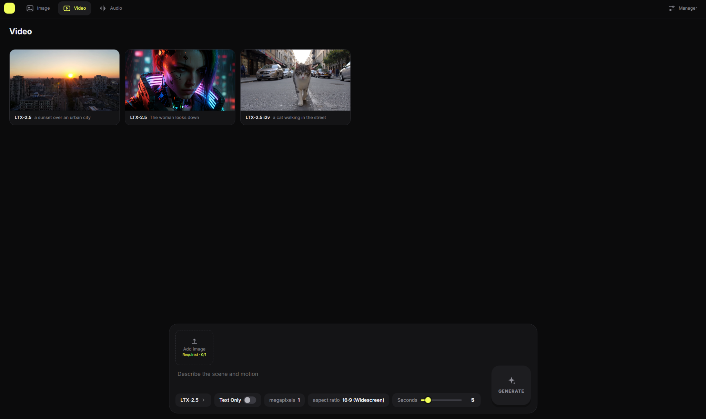

# Comfy Studio

**Turn any ComfyUI workflow into a simple app. Pick Image, Video or Audio, choose a model, type a prompt, drop in files, press Generate.**

A local, open-source, [Higgsfield](https://higgsfield.ai)-style interface that runs on top of your own ComfyUI. You never see a node graph. You name a few nodes in ComfyUI, export the workflow, drop the file into the **Manager**, and the interface builds itself from it.

Built for the [#OpenSourceHiggsfield](https://comfy.org/open-source-higgsfield/) challenge. MIT licensed.



## The idea

A ComfyUI API workflow already knows what it needs: an image here, a prompt there, a duration, a resolution. Comfy Studio reads **marks you type into node titles** and turns them into the right controls:

| In ComfyUI you name a node | The user sees |
|---|---|
| `CLIP Text Encode (Input)` | the prompt box |
| `Load Image (Input optional {Start frame})` | an optional upload box called "Start frame" |
| `Load Image (Input optional [image 1/10])` … `[image 10/10]` | one box that grows as pictures are added, with drag-to-reorder |
| `Resolution Selector (Input [1,2])` | aspect ratio and megapixels as drop-downs and number fields |
| `If/Else Switch (Switch {Custom ratio} [1])` | a toggle switch |
| `Some Node (Input Slider {Seconds} [5] min=3/max=15/stp=1/dec=0)` | a slider with limits, steps and decimals; click the number to type a value |
| `Load Diffusion Model (Setup {Main model} [1])` | a model picker in the Manager, for each person's own files |
| `Save Video (Output)` | the result, and which tab (Image, Video, Audio) the workflow lives in |
| `Seedance Reference to Video (Credits)` | a crown, and the live credit price on the Generate button |

The full list is in [docs/NAMING_GUIDE.md](docs/NAMING_GUIDE.md). It is also available inside the app under **Manager → Naming guide**.

## Features

- **Image / Video / Audio tabs.** The models in each tab are simply the workflows you have loaded.
- **One workflow, several modes.** An empty optional upload switches its node off and cuts it out of the graph. The same workflow can be text-to-video with only a prompt, or image-to-video once a picture is added. Studio works out by itself which uploads are required.
- **Multi-reference uploads.** Up to N images, audio files or videos share one box. Drag thumbnails to change the order, or drop a file from your file explorer onto a thumbnail to replace it.
- **Settings that fit the field.** Fixed options become drop-downs with the real choices from ComfyUI, numbers can be typed right in the button, true/false fields become switches, and `min= max= stp= dec=` set limits, steps and decimals, and typed numbers snap to the closest step.
- **Show and hide rules.** `{Custom ratio} on [1]` shows a setting only while a switch is on, with a fade.
- **Setup for every machine.** Model files differ from computer to computer. Fields marked `(Setup)` get their own panel with a drop-down of what is installed, and a missing file is highlighted in red before you can generate.
- **Closed-source models, with prices.** Partner (API) nodes carry a price formula in ComfyUI. Studio reads it and shows the credits for the exact settings and uploads you chose, updated live. These models get a crown.
- **Open weights work the same way.** Nothing in Studio depends on a partner node.
- **Results you can reuse.** Click any result to see everything that went into it, and copy the prompt or all of the inputs back into the current generation.
- **Manager.** Add workflows by dragging `.json` files in, replace, rename or delete them, move the sidebar to any edge, and remove all generations.
- **Comfortable to use.** The prompt box resizes from its top and sides and never shrinks below what its inputs need. There are smooth fades throughout, and reduced-motion settings are respected.
- **One click to start.** A launcher starts ComfyUI the same way your own `run_*.bat` does (without opening its browser tab) and then opens Studio.

## Quick start (Windows portable ComfyUI)

1. Copy this folder into your ComfyUI folder, the one that contains `main.py`:
   `ComfyUI_windows_portable\ComfyUI\comfy-studio`
2. Double-click **`Start Comfy Studio.bat`**.
3. In the browser tab that opens, click **Manager** and drag in one of your own workflows exported with **Workflow → Export (API)**. Open **⚠ Setup** to pick your own model files.
4. Choose a tab, pick a model, write a prompt, press **Generate**.

Optional: run **`Create Desktop Shortcut.bat`** once to get a "Comfy Studio" icon on your desktop.

**Already have ComfyUI running?** Use `Start Studio Only.bat`.
**Linux or macOS:** run `./start-comfy-studio.sh`, or start it by hand with ComfyUI's Python:

```
python studio.py
```

### What you need

- ComfyUI (the portable build, or a normal install with `main.py`). Studio uses ComfyUI's own Python and needs nothing else, because `aiohttp` is already part of ComfyUI.
- A current browser (Chrome, Edge, Firefox or Safari).
- Workflows exported with **Workflow → Export (API)**.

## Making a workflow into an app

1. In ComfyUI, double-click the title of the nodes you want people to control and add a mark, as in the table above.
2. Name the Save node `(Output)`. Without it the workflow is rejected.
3. Export with **Workflow → Export (API)**.
4. Drag the file into **Manager**. A field number that does not exist, or a model file that is missing, is shown in red.

Re-uploading a file with the same name replaces the old version and keeps each person's Setup choices.

## How it works

```
Browser (index.html) ◄──► studio.py (aiohttp, port 7860) ◄──► ComfyUI (port 8188)
   builds the controls          reads the marks                /object_info  field types, options, prices
   from the parsed workflow     prunes empty inputs            /upload/image inputs
   shows results and history    sends the graph                /prompt  /history  /view
```

- `studio.py` reads each workflow, finds the marks in the node titles, and asks ComfyUI's `/object_info` for field types, dropdown options and price formulas.
- When you press Generate it uploads your files, sets the values, and switches off every node whose upload is empty, together with anything that cannot run without it. It then queues the graph on `/prompt`.
- Prices come from the `price_badge` formula ComfyUI attaches to partner nodes. `studio.py` contains a small evaluator for the subset of the JSONata language those formulas use, and re-runs it whenever an input changes.
- There is no database. Workflows live in `workflows/`, each person's Setup choices in `setup/`, and the generation history in the browser.

### Settings

Environment variables, all optional:

| Variable | Default | Meaning |
|---|---|---|
| `COMFY_URL` | `http://127.0.0.1:8188` | where ComfyUI listens |
| `COMFY_DIR` | the folder above this one | the folder with ComfyUI's `main.py` |
| `COMFY_ARGS` | none | extra arguments when Studio starts ComfyUI |
| `COMFY_START` | `1` | `0` = do not start ComfyUI |
| `PORT` | `7860` | the port Studio listens on |
| `COMFY_CREDITS_PER_USD` | `211` | credits per US dollar for the price display |

## Project layout

```
studio.py            the server: mark parser, graph pruning, price formulas, ComfyUI client
index.html           the whole interface (no build step, no dependencies)
Naming Guide.html    the guide that opens inside the app
docs/                naming guide (Markdown) and screenshots
workflows/           your ComfyUI API workflows
tests/               logic tests (python -m unittest discover -s tests -v)
Start *.bat, *.sh    launchers
```

## Known limits

- Progress is shown by polling ComfyUI's history. There is no progress bar and no cancel button yet.
- Fields that hold several values in one widget, such as the LoRA rows of rgthree's Power Lora Loader, cannot be exposed.
- The credit price depends on the formula your ComfyUI version provides. If a formula is missing or uses something the evaluator does not know, the button says "uses credits", and the terminal explains why. `(Credits 351.6)` sets a fixed price instead.
- The launcher expects a ComfyUI folder with `main.py`. The installer-based ComfyUI Desktop app is not started automatically, but Studio works with it when you run **Start Studio Only** and set `COMFY_URL`.
- The interface is built for desktop screens.

## Contributing

See [CONTRIBUTING.md](CONTRIBUTING.md). Run the tests with `python -m unittest discover -s tests -v`.

## License

[MIT](LICENSE). Model weights, custom nodes and third-party assets keep their own licenses.
